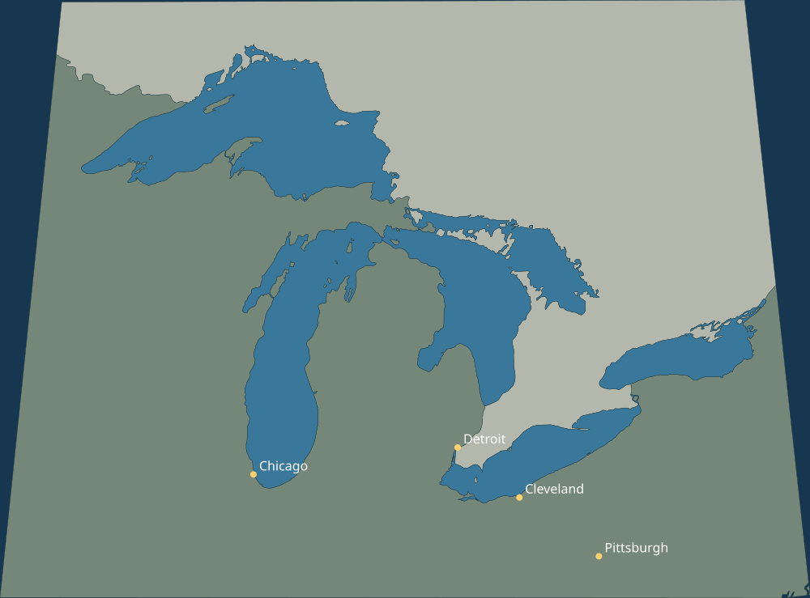

# AP02 – US-Geodaten und Importpipeline

Aktiver Neustart: `scenario.us.great_lakes.1913`, Szenariodatum **1913-01-01** als Metadatum.
Es gibt noch keine laufende Spielzeit oder Wirtschaft (AP04 ff.). AP03 ist nicht implementiert.
AP01 wurde vor Beginn von AP02 separat committed und auf origin/main gepusht: `69d15c3`
(Projektgrundlage `13d85d7`, anschließende Stabilisierung der Inputkonfiguration `69d15c3`).

## Umfang und historische Einordnung

Ein zusammenhängender WGS84-Ausschnitt von 93°W bis 75.5°W und 39.5°N bis 49.5°N zeigt
USA und Kanada als Kontext, alle fünf Großen Seen sowie Detroit, Chicago, Cleveland und Pittsburgh.
Die vier Teststädte gehören ausschließlich zu US-Spielregionen. Kanada ist Kontext und besitzt
keine aktive Wirtschaftsregion. Europa ist kein aktiver Szenariodatensatz; globale Quellarchive
enthalten naturgemäß auch außerhalb des Ausschnitts liegende Geografie.

**Die Natural-Earth-Daten sind moderne, generalisierte Geografie und keine verifizierte
Rekonstruktion der Küstenlinien und Grenzen von 1913.** Sie bilden hier den ausdrücklich
dokumentierten geografischen Näherungsstand. Stadtkoordinaten folgen den Natural-Earth-Ortspunkten,
nicht behaupteten historischen Stadtmittelpunkten. Keine historischen Verkehrs-, Produktions-
oder Bevölkerungswerte werden behauptet; keine modernen Straßen oder Autobahnen werden importiert.

Spielregionen entstehen deterministisch als nach Stadtpositionen gebildete Voronoi-Zellen,
verschnitten mit US-Land. Sie decken den US-Landanteil des Ausschnitts ab und überschneiden
sich nicht flächig. Sie heißen explizit „Spielregion“, tragen `region.test.*`-IDs und `is_test=true`.
Dies sind keine frei erfundenen Länder und keine behaupteten historischen Verwaltungsgrenzen.
Jede Stadt hat genau eine Region-ID. Spätere Markt-IDs und Wirtschaftsregeln sind nicht vorweggenommen.

## Projektion, Koordinaten und Entfernung

Maßgebliche Konstanten und C++-Transformation: `Source/ConflictOfInterest/GeoTransform.h`.
Der Python-Importer liest dieselben Konstanten; die Projektion selbst berechnet er unabhängig
mit PROJ. Der UE-Test vergleicht C++ gegen diese unabhängigen Projektionsreferenzen.

- Projektion: **sphärische Lambert Conformal Conic, 2SP**, eigener regionaler Parameterstand,
  kein fälschlich behaupteter EPSG-Code.
- Ursprung: 44.5°N, 84.5°W; Standardparallelen 40°N und 48°N.
- Kugelradius: 6371.0088 km; 7 UE-Einheiten pro geografischem km.
- UE +X = Nordwert, +Y = Ostwert, +Z = oben. Landflächen flach, zentriert und verkleinert.
- Rohdaten bleiben in den ZIP-Dateien in WGS84 erhalten; die ausgeschnittenen WGS84-Geometrien
  stehen zusätzlich in `GeoData/Generated/map.json`. Geometrie/Projektion sind nicht im Renderer codiert.

Die Darstellungseinheiten sind keine Fahrstrecke. Die Distanzfunktion berechnet Haversine-Luftlinie
direkt aus WGS84-Winkeln. Unabhängige Referenz: `pyproj.Geod(ellps='WGS84')`.

| Strecke | Kugelmodell | Unabhängiges WGS84-Ellipsoid | Abweichung |
|---|---:|---:|---:|
| Chicago–Detroit | 382.032 km | 383.007 km | 0.255 % |
| Cleveland–Pittsburgh | 183.395 km | 183.585 km | 0.104 % |

Toleranz für den dokumentierten Modellunterschied: <0.5 %. Keine Reisezeiten aus Meshabständen.
Eine andere Projektion benötigt einen Austausch der zentralen Transformation und erneuten Import.
Weltweite Darstellung, Polnähe und Datumsgrenze bleiben spätere Aufgaben; diese regionale LCC
wird nicht ungeprüft weltweit verwendet.

## Geometrie und Darstellung

Offline werden die Seen einmal topologieerhaltend vereinfacht (1.4 UE-Einheiten = 200 m), dann
exakt dieselben projizierten Seegeometrien aus beiden Länder-Landflächen subtrahiert. Die
Spielregionen werden aus diesem Land berechnet. Land und Wasser überschneiden sich deshalb
nicht flächig. Löcher in den Seegeometrien erhalten Inseln; Mehrfachpolygone werden einzeln
trianguliert und gemeinsam in ein StaticMesh je Fläche gespeichert.

Mapbox Earcut erhält Außenringe und Innenringe. Jedes Dreieck wird auf Abdeckung und Flächeninhalt
geprüft. Ein zusätzlicher synthetischer Insel-/Loch-Test deckt Geometrien unabhängig vom aktuellen
Quellbestand ab. Kleine Flüsse und weitere Binnenseen werden noch nicht vollständig dargestellt;
nur die fünf Großen Seen werden aus dem Land entfernt.

Der Editor erstellt persistente StaticMeshes für Land, Seen, Spielregionen, Regionskonturen und
einen gemeinsamen Stadtmarker-Mesh. Die Marker sind nur Symbole, keine maßstäblichen Flächen.
Materialfarben unterscheiden Kontext und Spielgebiete; Auswahl, Informationspanels und adaptive
Beschriftungen gehören erst zu AP03. Eine benannte, aus denselben Vertices erzeugte Prüfansicht:



## Offline reproduzieren

Im Repository, mit Python 3.14 (getestet):

```powershell
python -m venv .venv
.\.venv\Scripts\python.exe -m pip install -r Tools\requirements.txt
# Normaler Import: keine Netzwerkzugriffe, Quellen sind bereits versioniert.
.\.venv\Scripts\python.exe Tools\import_geodata.py
```

Nur zum erstmaligen Bezug/Prüfen derselben Upstream-Dateien ist `--download` vorgesehen.
Weicht ein vorhandenes Archiv vom Download ab, wird der Austausch verweigert. Einen neuen
Quellstand separat prüfen und bewusst versionieren. Quelle, Version, Snapshotdatum und SHA256
stehen in `GeoData/Generated/validation.json`. Ein erneuter Offline-Import muss dieselbe tatsächliche
map.json-Prüfsumme liefern. Die Abhängigkeiten sind fest versioniert; virtuelle Umgebungen gehören
nicht ins Repo. Für die Prüfung hier wurde die vorhandene lokale Python-Umgebung mit genau diesen
Versionen verwendet.

Danach:

1. `Tools/Build.ps1 -EngineRoot E:\UE_5.8 -Target Editor` ausführen.
2. `ConflictOfInterest.uproject` öffnen. Falls Windows die Endung nicht zugeordnet hat:
   Unreal starten → Meine Projekte → Durchsuchen → Projektdatei auswählen.
3. Play beenden. In der **Unreal-Konsole** unten `CoI.RebuildMap` ausführen.
4. Auf `COI_MAP_OK GreatLakes1913 countries=2 lakes=5 regions=4 cities=4` im Log achten.
5. Das Level `/Game/Maps/GreatLakes1913` wird gespeichert und ist das Standardlevel.

Fehlt der neue Level beim ersten Start, erzeugt das Editor-Modul ihn einmalig nach dem Editorstart,
sofern der vorherige Python-Import gültig ist. Ein gescheiterter C++-Validierungsschritt ersetzt kein
Level. Der Neuaufbau überschreibt bewusst nur generierte Assets; eigene manuelle Änderungen an
diesen generierten Assets gehen dabei verloren. Quelldaten und Code sind die bearbeitbare Grundlage.
Kein Import während Play; der Editor weist diesen Versuch ab.

Alternative für lokal funktionierende Commandlet-Ausführung:

```powershell
& 'E:\UE_5.8\Engine\Binaries\Win64\UnrealEditor-Cmd.exe' '.\ConflictOfInterest.uproject' -run=CoIBuildMap -unattended -nullrhi -nop4
```

Der tatsächlich geprüfte Importweg hier ist der interaktive Editor. Ein Commandlet-Exitcode allein
genügt nicht: das Log muss den genannten Erfolgsmarker enthalten. AP01 bleibt im separaten
`CameraPrototype`-Level erhalten; der Commandlet-Schalter `-Prototype` erzeugt dieses Platzhalterlevel.

## Runtime und Cooking

Runtime und Editor sind getrennte Module. Meshaufbereitung, Projektion der Grenzen, Vereinfachung
und Triangulierung laufen offline bzw. im Editor. Bei Spielstart wird nur der bereits importierte
Geokatalog validiert und die Kamera konfiguriert; es werden keine Grenzen neu verarbeitet.

`/Game/Geography/Data/GeoCatalog` enthält unveränderliche Definitionen und Herkunftsdaten. Eine
einzige `CoIGeoReference` im Level referenziert das DataAsset für Cooking. StaticMeshes und
Materialien werden von den Level-Komponenten direkt referenziert. Beide Levels stehen in MapsToCook.
Das Spiel benötigt weder Python noch lose Raw-Dateien noch einen Kartendienst. Ein paketierter
Standalone-/Cook-Test ist noch nicht durchgeführt; er bleibt ein expliziter lokaler Prüfschritt.

## Automatisierte und visuelle Prüfschritte

- `Automation RunTests CoI.` im Editor ausführen und die vollständige Testwarteschlange abwarten.
- Kamera-Test aus AP01 bleibt aktiv. Geografie-Test prüft C++-gegen-PROJ-Referenzen,
  beide unabhängigen Entfernungen, Szenariodatum, Katalogreferenzen und dass Lake Michigan
  nicht als US-Land gefüllt ist. Beschädigte Schema-Daten dürfen keinen Teilzustand übernehmen.
- In Play den Seenverlauf und die vier orangefarbenen Stadtmarker mit der Prüfansicht oben vergleichen.
  Hineinzoomen: größere Inseln und Seeausschnitte dürfen nicht mit Wasser/Land gefüllt werden,
  das laut Quelldaten ein Loch ist. Die Quellen sind generalisiert, keine Katasterdaten.
- Offline-Import wiederholen und SHA256 vergleichen; Testregionen müssen flächendeckend und
  überschneidungsfrei auf US-Land liegen. Keine aktive Stadt/Region aus Europa zulässig.

Quellen, Lizenz und Werkzeuglizenzen: [Geodatenquellen](Sources.md).

## Tatsächlich geprüft am 16.11.2026

- Editor- und Game-Development-Build mit UE 5.8.4: erfolgreich.
- Zwei vollständige Editorimporte: `COI_MAP_OK`, jeweils 2 Länder, 5 Seen, 4 Regionen, 4 Städte.
- Beide UE-Automationstests erfolgreich; Warteschlange mit 2 ausgeführten Tests abgeschlossen.
  Auszüge stehen in [AP02_TestEvidence.txt](AP02_TestEvidence.txt).
- Play: Übersicht, Stadtpositionen, Nordausrichtung, Zoom und größere Insel-/Uferformen visuell geprüft.
- Wiederholter Offline-Import ergibt denselben SHA256 für `map.json`:
  `05566a210b81f2451d1415bb235fd65f48d2d6a5223ba7ef8e47bd9ea05e7dd6`.

Der Import entfernt Dreiecke unter 1e-8 Quadrat-UE-Einheiten als numerische Rundungsreste
(aktuell ein Dreieck in Lake Michigan). Flächenvergleich und symmetrische Differenz gegen die
Quellpolygone müssen trotzdem die dokumentierte Toleranz bestehen; Inseln werden dadurch nicht
entfernt. Der erste Editorimport hatte diesen Rest korrekt abgewiesen. Der korrigierte Import
und beide anschließenden UE-Tests sind erfolgreich.
