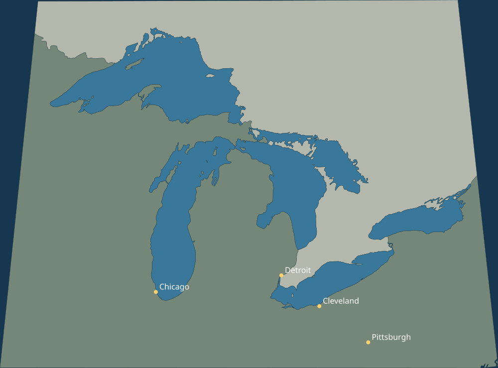

# Conflict of Interest

**Entwicklungsregel ab 20.11.2026:** Keine Migration alter Speicherstände. Nur das aktuelle Save-Format wird geladen; bei inkompatiblen Änderungen beginnt eine neue Partie. Verbindliche Regel: [AGENTS.md](AGENTS.md).

Spielbeginn 01.01.1913. Neue geografische Zielvorgabe: **Deutschland/Niederlande 1913**.
Verbindlicher Entwurf: [Entwicklungsauftrag](Docs_DevelopmentBrief.md).
Umgesetzt: **AP01 bis AP09.4, UI01 und MAP01 (historischer Datenplan)**.
[MAP01](Docs/MAP01.md) legt 50 Regionen/Hubs, Quellen, Gewässer und die Integrationsfolge fest.
Bis zum Kartenimport ab MAP02 bleibt der vorhandene Großer-Seen-US-Teststand spielbar.



## Voraussetzungen und Start

- Unreal Engine **5.8.4** (vorhandene lokale Installation: `E:\UE_5.8`).
- Visual Studio 2022 C++ Toolchain und Windows SDK, wie von dieser UE-Version unterstützt.
- Kein zusätzlicher kostenpflichtiger Dienst oder Asset erforderlich.
- `ConflictOfInterest.uproject` öffnen und fehlende Module bauen lassen oder vorab:

```powershell
./Tools/Build.ps1 -EngineRoot E:\UE_5.8 -Target Editor
```

Die EngineAssociation verwendet die vorhandene lokale Engine-Registrierung. Auf einem anderen
Rechner im Explorer „Switch Unreal Engine version“ auf eine kompatible UE 5.8 umstellen.
`COI_ENGINE_ROOT` oder `-EngineRoot` konfiguriert das Buildskript ohne Änderungen am Quellcode.

Falls Windows keine `.uproject`-Dateizuordnung hat: Unreal Engine starten → Meine Projekte → Durchsuchen → `ConflictOfInterest.uproject` auswählen.

Standardlevel: `/Game/Maps/GreatLakes1913`, dann **Play**. Die vier orangefarbenen Marker stehen
für Chicago, Detroit, Cleveland und Pittsburgh. Spielregionen liegen ausschließlich in den USA;
Kanada dient als geografischer Kontext. Auswahl, Ortsinformationen und Kartenansichten: [AP03](Docs/AP03.md), [AP04](Docs/AP04.md).

Die generierten `.umap`/`.uasset`-Dateien sowie Roharchive, Szenario und Importer sind versioniert.
Zum Offline-Neuimport und zur genauen Editor-Reihenfolge: [AP02](Docs/AP02.md).
`CoI.RebuildMap` baut jetzt die US-Karte; `CameraPrototype` bleibt als AP01-Level erhalten.

WASD/Pfeile bewegen die Kamera, Mausrad zoomt zum Punkt unter dem Mauszeiger. Escape beendet
Play; falls der Fokus nicht im Viewport liegt, den roten Stop-Knopf verwenden. Shift+F1 gibt den
Mausfokus frei. Nord ist +X, Ost +Y; Kartenebene Z=0.

AP01-Fokusgrenzen: X/Y jeweils ±6500; Höhe 600–22000, Start 17000.
AP02 lädt Fokusgrenzen, Zentrum und Übersichtshöhe aus dem Geokatalog. Die Fokusgrenze hat am Rand
Vorrang vor dem Mausanker. Geschwindigkeit skaliert mit Zoom und DeltaSeconds; Diagonalen sind
normalisiert. Legacy Input ist vollständig per Config eingerichtet, ohne zusätzliche Input Assets.

## Aufbau und Versionsverwaltung

- `Source/ConflictOfInterest`: Kamera, Controller, GameMode und reine Kameramathematik.
- `Source/CoIEditor`: editorgebundener, wiederholbarer Aufbau des generierten Levels.
- `Config`: Startlevel, Input, Renderer und Cooking-Referenzen.
- `Content`: tatsächlich erzeugte `.umap`/`.uasset`-Dateien, bewusst in Git versioniert.
- `Docs`: Architektur, Paketabnahme und Einschränkungen.

Engine, Binaries, Intermediate, DerivedDataCache, Saved, IDE-Dateien und lokale Python-Umgebungen
gehören nicht ins Repository. Das alte Europa-Projekt `firstgame` liegt außerhalb dieses Repos und
wurde nicht verändert. Nur die grundlegende Kameratechnik wurde bewusst neu umgesetzt.

Der Simulationskern aus [AP04](Docs/AP04.md) läuft in festen Schritten und startet pausiert. Start/Pause sowie 1x/4x/16x steuern die Spielzeit. [AP05](Docs/AP05.md) aktiviert Produzenten, Beschäftigung/Löhne, regionale Orderbücher, Haushaltskonsum und bezahlte Transporte; kein wirtschaftlicher Actor-Tick.
Geografische Definitionen bleiben statische Daten. Das externe JSON-Startszenario, getrennte Laufzeitdaten, Konten, Reservierungen und Assets laufen unter `Source/ConflictOfInterest/Simulation`. Stadt/Region auswählen und die Diagnoseleiste scrollen; ohne Auswahl erscheint die globale Bilanz. Alle Wirtschafts- und Bevölkerungswerte sind fiktive Testwerte.

## Prüfung

UE-Konsole: `Automation RunTests CoI.`, bis „Test Queue Empty“ abwarten.
Weitere Schritte und tatsächlich ausgeführte Prüfungen: [AP01](Docs/AP01.md), [AP02](Docs/AP02.md), [AP03](Docs/AP03.md), [AP04](Docs/AP04.md).


Das [Spieler-HUD aus AP06](Docs/AP06.md) ersetzt das bisherige Diagnosepanel als Hauptoberfläche. Märkte, Lager, Transporte und Unternehmen verbinden Kauf → bezahlte Lieferung → Verkauf; Bestätigungen senden echte Simulationsbefehle. Diagnose bleibt separat schaltbar. Escape schließt zuerst den Dialog, dann die Arbeitsansicht. Bei pausierter Simulation werden gesendete Befehle erst nach Start umgesetzt. Bedienung, Testwerte und bekannte Grenzen stehen in der AP06-Dokumentation.

[AP06a](Docs/AP06a.md): Vor Spielbeginn kann PlayerCompanyId im Szenario ein bestehendes spielbares Handelshaus, einen Produzenten oder den Transportbetrieb übernehmen; Besitz und Geld bleiben reguläre Firmendaten.

[AP07.1](Docs/AP07.1.md): Versorgung und echte gewichtete Tagespreise als Kartenlayer, getrennte Haushalts-/Inputansicht, konfigurierbare Preisgrenzen und klare Zustände für fehlende Daten/Nullbedarf.

[AP07.2](Docs/AP07.2.md): gerichtete Routen, freigegebene öffentliche Aktivitätsaggregation und begrenzte Lkw-Beispiele aus veröffentlichter Spielzeit.

[AP07.3](Docs/AP07.3.md): Karte/Markt/Lager/Transporte verbinden, Planung vorbelegen und Objekte auf der Karte zentrieren; Tests und Messvergleich dokumentiert.

[AP07a](Docs/AP07a.md): lokale Entwicklerkonsole mit F10 (nur Editor/Development), sicheren Eingriffen, budgetiertem Stunden-Vorschub und JSONL-Journal. `help` listet Befehle; Shipping enthält keine Entwickler-Endpunkte.

[AP08.1](Docs/AP08.1.md): gemeinsame Stadthubs, getrennte Hauptsitze/Heimatorte und begrenzte physische Umlandquellen; Migration ohne zusätzliche Assets.

[AP08.2](Docs/AP08.2.md): Stadtbildschirm mit Übersicht, bestehenden lokalen Markt-/Lager-/Transportaktionen, eigenen Assets und transparent noch nicht ausführbaren Investitionen. Einstieg über „Stadt“ oder die Kartenauswahl.

[AP08.3](Docs/AP08.3.md): Stadt → Investitionen ermöglicht gedeckten Lager-/Farmbau, verzögerten Lagerausbau und Käufe ausdrücklich angebotener unbelasteter Assets. Kosten, Dauer, Bauplätze und Angebote liegen im Szenario.

[AP08.4](Docs/AP08.4.md): „Spielstände“ bietet drei lokale Speicherplätze für vollständige Partien einschließlich laufender Bau-/Ausbauprojekte, teilgefüllter Orders und Transporte. Laden prüft Version, Konfiguration, Referenzen und Bilanzen und startet mit der gespeicherten Firma pausiert. Dateien liegen in `Saved/SaveGames`; keine automatische Offline-Fortschreibung.

[AP08.5](Docs/AP08.5.md): Stadt → Eigene Assets → Lager-/Betriebsregeln steuert expliziten automatischen Einkauf/Verkauf, Ziele/Reserven, Preislimits, Kaufbudgets, geplante Auslastung und Lohnangebote. Gemeinsame Konten/Bestände werden nicht mehrfach reserviert. Regeln und Fälligkeiten werden mitgespeichert. Historischer AP08.5-Stand: Save-Version 2; aktuell gilt die unten genannte AP08.6-Version.

[AP08.6](Docs/AP08.6.md): Transporte → Lieferregeln plant interne und zustimmungspflichtige externe Dauerversorgung mit realen bezahlten Hin-/Rückfahrten. Fehltermine, Teilmengen und Marktauffüllung sind nachvollziehbar; Standortberichte trennen Zahlungen, interne Verrechnung und Lagerbuchwert. Historischer AP08.6-Stand: Save-Version 3; ältere Versionen 1/2 bleiben unverändert inkompatibel.

[AP09.1](Docs/AP09.1.md): Bestandsaufnahme, verbindliche Phasen-/Migrationsplanung und ausführbare 30-Tage-Referenz.

[AP09.2](Docs/AP09.2.md): gemeinsamer Lohnlauf für Produktions-, Lager-/Handels- und Fahrzeugstellen; reale Gruppenersparnisse, Sparziele, verzögerter Wohlstand und Haushaltsanzeige in Stadt → Übersicht. Direkte Haushaltskäufe bleiben ausdrücklich Übergangsmodus bis AP09.3. Historischer AP09.2-Stand: Save-Version **4**; ältere Versionen bleiben unverändert inkompatibel.

[AP09.3](Docs/AP09.3.md): Lebensmittelgeschäfte und Gemischtwarenläden nutzen reale Bestände, Beschäftigung und bezahlten Nachschub. Haushalte kaufen ausschließlich im Einzelhandel; Preis/Qualität beeinflussen die Verteilung. Stadt → Eigene Assets → Lagerregeln steuert Sortimentspreise/Nachschub, Investitionen bietet Bau/Ausbau/Kauf. Save-Version **5** migriert geprüfte Version-4-Partien einschließlich laufender B2B-/Lieferaufträge; ältere Versionen 1–3 bleiben inkompatibel. Standardszenario weiterhin stark unterversorgt; Abnahmen und Grenzen dokumentiert.

[UI01](Docs/UI01.md): gemeinsame Snapshot-Kennzahlen, korrekte eigene Mitarbeiter-/Standortzählung, erklärte fehlende Monats-/Bewertungsdaten und einheitliche USD-/Prozent-/Mengenformate. Geldfelder erwarten USD mit maximal zwei Nachkommastellen (ohne Tausendertrennzeichen); interne Buchungen bleiben centgenau. UI02–UI06 folgen getrennt.

[AP09.4](Docs/AP09.4.md): durchgängige Waren-/Herstell-/Frachtkosten, realisierte Kalender-Monatsergebnisse und aufschlagsbasierte neue Verkaufspreise. Markt-/Ladenverkäufe werden mit Prozentaufschlag gesteuert; Einkaufslimits und feste Lieferverträge behalten ihren Zweck. Save-Version **6** lädt ausschließlich die aktuelle Version; alte Partien werden während der Entwicklung nicht migriert. 73 Tests und ein 40-Tage-Monatsabgleich prüfen den Kostenfluss; keine garantierten Gewinne oder Geld-/Warenzugaben.
